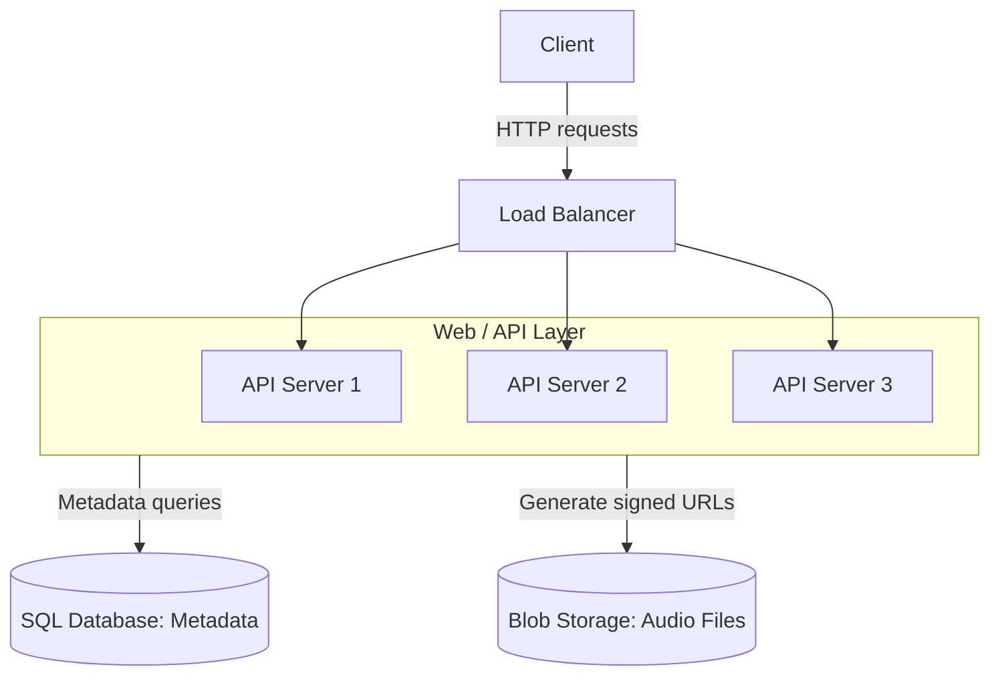
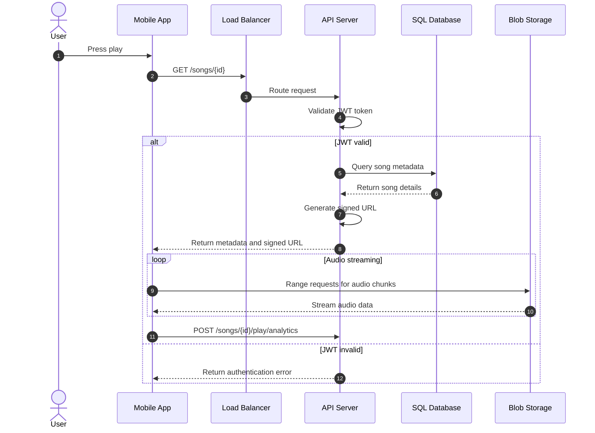
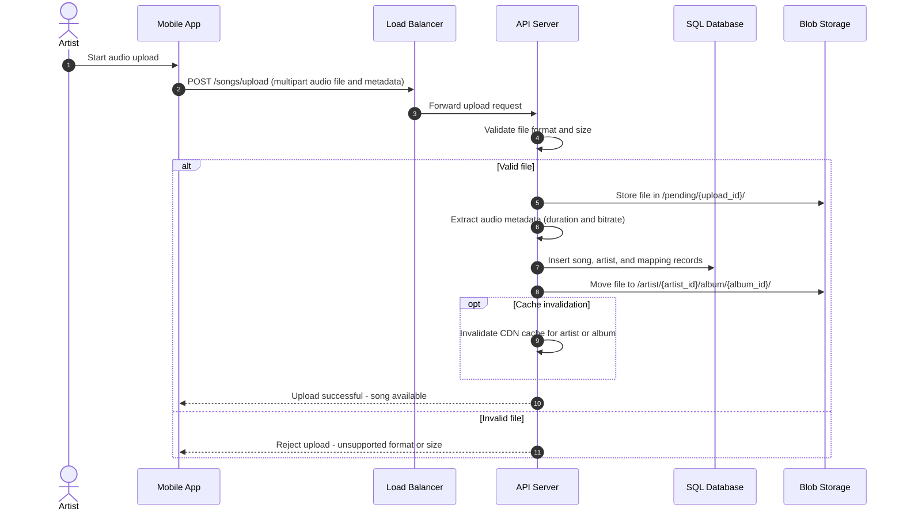
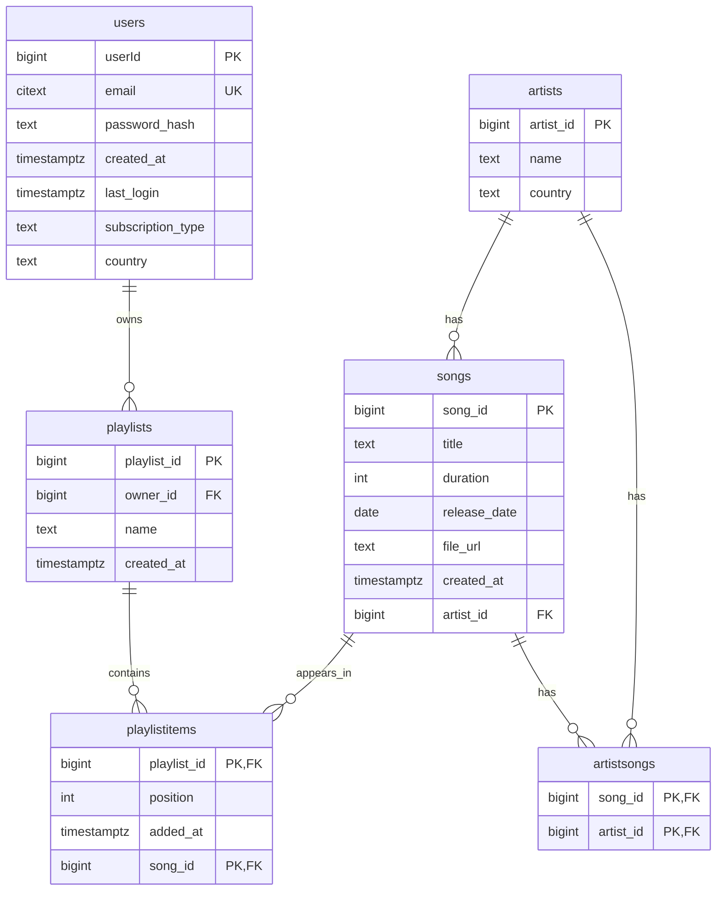

# Spotify System Design

## 1. Requirements & Assumptions

Roughly **500,000 users** listen to a catalog of about **30 million songs**.

### Core requirements

- Artists can upload their songs.
- Users can search for and play songs.
- Users can create and manage playlists.
- Users can maintain profiles.
- The system provides basic monitoring and observability, including health checks, error tracking, and performance metrics.

### Audio formats and quality

Use **Ogg** and **AAC** files with different bitrates for adaptive streaming:

- **64 kbps:** Mobile data saving.
- **128 kbps:** Standard quality.
- **320 kbps:** Premium users.

On average, one song file at standard quality takes about **3 MB** of storage.

## 2. Capacity Planning

### Song storage

- **3 MB × 30 million songs ≈ 90 TB** of raw audio data.
- This excludes replicas across different regions.
- This also excludes versioning overhead when artists re-upload songs.
- Plan for approximately **2–3×** the raw audio storage amount.

### User metadata

- Includes user profiles, preferences, and playlist data.
- **1 KB × 500,000 users ≈ 0.5 GB**.

### Song metadata

- Each song needs a title, artist references, duration, file URLs, and other metadata.
- **100 bytes per song × 30 million songs ≈ 3 GB**.
- Metadata storage is small compared with audio storage.

### Daily bandwidth

- Average listening time is **3.5 minutes** per song at **128–160 kbps**.
- This is roughly **3–4 MB per stream**.
- Assume each user streams **10–15 songs daily**.
- Streaming at this scale leads to significant egress costs.

## 3. High Level Architecture



- **Client:** Sends HTTP requests.
- **Load balancer:** Routes requests to the API servers.
- **Web / API layer:** Handles application requests, queries metadata, and generates signed URLs.
- **SQL database:** Stores relational metadata.
- **Blob storage:** Stores audio files.

## 4. System Workflow

### 4.1 Read Flow — Song Playback



### 4.2 Write Flow — Song Upload



> Conversion note: The source image swaps the SQL and blob-storage destinations for the upload operations. The flow above follows the operation labels: audio files go to blob storage, and relational records go to SQL.

## 5. API Design

### Search & Discovery

- **Search different content types with pagination:**

  ```http
  GET /search?q={query}&type=song,artist&limit=20&offset=0
  ```

- **Get trending songs, optionally filtered by genre:**

  ```http
  GET /songs/trending?genre={genre}&limit=50
  ```

- **Get all songs by a specific artist:**

  ```http
  GET /artists/{id}/songs?limit=50
  ```

### Content Access

- **Get song metadata and a streaming URL:**

  ```http
  GET /songs/{id}
  ```

- **Stream directly through an endpoint as an alternative to signed URLs:**

  ```http
  GET /songs/{id}/stream
  ```

- **Get playlist details with an optional song list:**

  ```http
  GET /playlists/{id}?include_songs=true
  ```

### User Actions

- **Create a new playlist:**

  ```http
  POST /playlists
  ```

- **Add songs to a playlist:**

  ```http
  PUT /playlists/{id}/songs
  ```

- **Remove a song from a playlist:**

  ```http
  DELETE /playlists/{id}/songs/{song_id}
  ```

- **Like or unlike a song:**

  ```http
  POST /songs/{id}/like
  ```

### User Management

- **Get the current user's playlists:**

  ```http
  GET /users/me/playlists
  ```

- **Get songs liked by the current user:**

  ```http
  GET /users/me/liked-songs?limit=50&offset=0
  ```

- **Follow an artist:**

  ```http
  POST /users/me/follow/{artist_id}
  ```

## 6. Data Storage

### Audio files

- Store audio files in **blob storage**.
- Treat audio files as immutable; they rarely change once uploaded.
- Organize files by artist, album, and song:

  ```text
  /artist/{artistId}/album/{albumId}/{songId}.ogg
  ```

### Relational database



- **users:** Stores user accounts and profile information.
- **playlists:** Stores playlists and their owners.
- **playlistitems:** Links songs to playlists and stores each song's position and the time it was added. The composite primary key is `(playlist_id, song_id)`.
- **songs:** Stores song metadata, an audio file URL, and an artist reference.
- **artists:** Stores artist information.
- **artistsongs:** Maps songs to artists. The composite primary key is `(song_id, artist_id)`.

**Key:** `PK` = primary key, `FK` = foreign key, `UK` = unique key.
